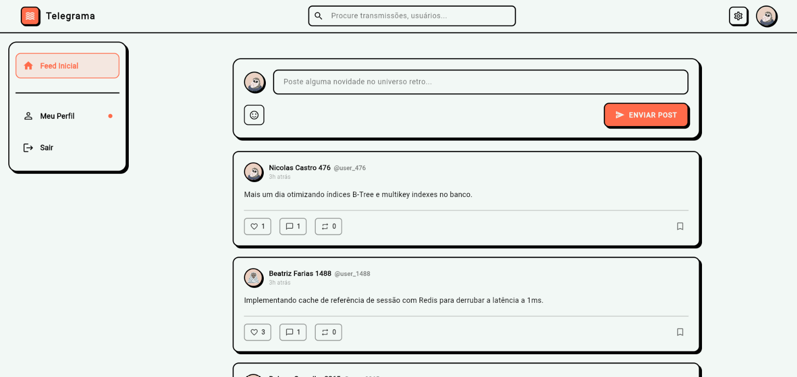
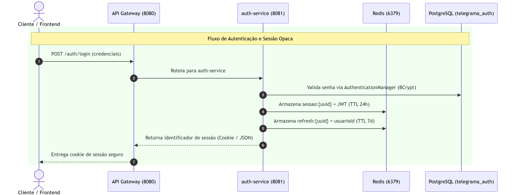

# 📟 Telegrama — Rede Social com Persistência Poliglota & Microsserviços

<div align="center">

<p align="center">
  
</p>

[](https://arapiraca.ufal.br/)
[](https://www.oracle.com/java/)
[](https://spring.io/projects/spring-boot)
[](https://spring.io/projects/spring-cloud)
[](https://flutter.dev/)
[](https://www.postgresql.org/)
[](https://www.mongodb.com/)
[](https://redis.io/)
[](https://www.docker.com/)

**Uma rede social deliberadamente calma, descentralizada e minimalista, construída sobre o manifesto *Slow Tech* e sustentada por uma infraestrutura distribuída com persistência poliglota (*Database-per-Service*).**

[Visão Geral](#-introdução-e-filosofia-slow-tech) • [Arquitetura](#-arquitetura-do-sistema) • [Conexão dos Serviços](#-conexão-e-comunicação-entre-microsserviços) • [Persistência Poliglota](#-estratégia-de-persistência-poliglota) • [Remoção do Feed Service](#-análise-arquitetural-remoção-do-feed-service) • [Estrutura](#-estrutura-de-arquivos-e-diretórios) • [Contribuições](#-histórico-e-divisão-de-contribuições-auditoria-git) • [Como Rodar](#-como-executar-o-projeto)

</div>

---

## 📻 Introdução e Filosofia "Slow Tech"

O ecossistema digital contemporâneo é saturado por mecanismos predatórios de retenção de atenção, estímulos visuais agressivos e algoritmos opacos de recomendação que fragmentam o foco do usuário. 

O **Telegrama** nasce como um contraponto acadêmico e tecnológico a essa dinâmica:
- **Estética Retrô Anos 2000:** Linhas arredondadas, paleta neutra e opções de alto contraste suave inspiradas nos monitores de fósforo verde (*Retro Green*) e monocromáticos do início do milênio.
- **Transparência Cronológica:** O feed apresenta rigorosamente a ordem temporal de publicação das mensagens (*waves* ou transmissões). Não há ordenação orientada a anúncios ou vigilância comportamental.
- **Soberania do Usuário:** Liberdade de customização de temas visuais, controle estrito de frequências de alerta sonoro e modo de privacidade soberana.
- **Engenharia Resiliente:** Uma interface leve e silenciosa para o utilizador, sustentada por um ecossistema poliglota tolerante a falhas, com baixa latência e alta consistência transacional.

<div align="center">

### 🖼️ Interface Principal da Plataforma
<p align="center">
  
</p>
<p><em>Figura 1: Feed cronológico limpo com cards arredondados e suporte ao tema retrô.</em></p>

</div>

---

## 🏛️ Arquitetura do Sistema

O backend foi arquitetado no padrão **Database-per-Service**, onde cada microsserviço isola suas regras de negócio e possui propriedade soberana sobre o seu banco de dados:

<div align="center">

<p align="center">
  
</p>

</div>

```
                            [ Cliente Flutter ] (Web / Desktop / Mobile)
                                    │
                                    │ HTTP / REST (Cookies HttpOnly + X-Session-Id)
                                    ▼
                      ┌───────────────────────────┐
                      │    API Gateway (8080)     │
                      │  Spring Cloud Gateway     │
                      └─────────────┬─────────────┘
                                    │
             ┌──────────────────────┼──────────────────────┐
             │ Consulta Sessão      │ Descoberta Dinâmica  │
             ▼                      ▼                      │
     ┌───────────────┐     ┌───────────────────┐           │
     │  Redis Cache  │     │ Service Discovery │           │
     │  (Porta 6379) │     │  Eureka (8761)    │           │
     └───────────────┘     └───────────────────┘           │
             ▲                                             │
             │           Encaminha com JWT no Header       │
             │           "Authorization: Bearer <token>"   │
             │                                             ▼
     ┌───────┴─────────────┐    ┌─────────────────────┐    ┌─────────────────────┐
     │    auth-service     │    │user-profile-service │    │    post-service     │
     │    (Porta 8081)     │    │    (Porta 8083)     │    │    (Porta 8082)     │
     └──────────┬──────────┘    └──────────┬──────────┘    └──────────┬──────────┘
                │                          │                          │
                │ OpenFeign (Sync)         │ OpenFeign (Batch)        │
                │                          ◄──────────────────────────┤
                ▼                          ▼                          ▼
     ┌─────────────────────┐    ┌─────────────────────┐    ┌─────────────────────┐
     │  PostgreSQL (Auth)  │    │ PostgreSQL (Profile)│    │   MongoDB (Posts)   │
     │    telegrama_auth   │    │  telegrama_profile  │    │   telegrama_posts   │
     └─────────────────────┘    └─────────────────────┘    └─────────────────────┘
```

### Componentes Nucleares
1. **API Gateway (`api-gateway` - Porta `8080`):** Ponto único de entrada (*Single Entry Point*). Gerencia terminação de CORS, validação de tokens de referência no Redis, conversão para JWT e roteamento balanceado.
2. **Service Discovery (`service-discovery` - Porta `8761`):** Servidor Netflix Eureka para registro dinâmico de instâncias e resolução de nomes de serviço (`lb://`).
3. **Serviço de Autenticação (`auth-service` - Porta `8081`):** Responsável por credenciais, hashing BCrypt, políticas de papéis (`USER`, `ADMIN`) e emissão de sessões. Banco: **PostgreSQL (`telegrama_auth`)**.
4. **Serviço de Perfis e Grafo Social (`user-profile-service` - Porta `8083`):** Responsável por identidades públicas, customização de preferências e grafo direcionado de seguidores. Banco: **PostgreSQL (`telegrama_profile`)**.
5. **Serviço de Postagens e Feed (`post-service` - Porta `8082`):** Centraliza o ciclo de vida de publicações, reações atômicas (curtidas, reposts, salvos) e geração de feed cronológico com comentários aninhados em árvore. Banco: **MongoDB (`telegrama_posts`)**.

---

## 🔄 Conexão e Comunicação entre Microsserviços

A malha distribuída do Telegrama emprega padrões consolidados para garantir desacoplamento, segurança e alta vazão:

### 1. Padrão Token Mediating / Reference Token (BFF + Redis)
- O cliente móvel/web **não manipula JWTs de longa duração diretamente**, mitigando riscos de vazamento via XSS.
- No login, o `auth-service` valida a senha no PostgreSQL e grava uma chave volátil no Redis:
  $$\texttt{sessao:\{UUID\}} \rightarrow \text{JWT (TTL 24h)}$$
- O cliente recebe apenas o identificador opaco via cookie protegido (`HttpOnly`, `SameSite=Lax`) e no cabeçalho customizado `X-Session-Id`.
- A cada requisição, o `api-gateway` valida a sessão no Redis em **$O(1)$ na memória RAM ($< 0.8$ ms)** e injeta o JWT no cabeçalho interno `Authorization: Bearer <token>`.

### 2. Comunicação Síncrona Declarativa (Spring Cloud OpenFeign)
- **Registro Coordenado:** No cadastro de um novo nó, o `auth-service` grava a credencial com BCrypt e dispara uma chamada síncrona Feign (`POST /usuarios/interno/perfil`) para o `user-profile-service`, inicializando a identidade e as preferências do perfil em 3FN.
- **Enriquecimento em Lote (*Batch Enrichment*):** Ao listar postagens, o `post-service` extrai todos os IDs únicos de autores da página do MongoDB e faz **uma única requisição Feign** (`POST /usuarios/batch`) para o `user-profile-service`, eliminando completamente o problema de **$N+1$ requisições HTTP**.

<div align="center">

<p align="center">
  
</p>
<p align="center">
  
</p>
<p><em>Figura 2: Diagramas de sequência ilustrando o fluxo síncrono com validação de sessão no Redis e enriquecimento em lote.</em></p>

</div>

---

## 🗄️ Estratégia de Persistência Poliglota

O Telegrama resolve a impedância funcional dos dados combinando três motores especializados:

<div align="center">

<p align="center">
  
</p>

<p align="center">
  
</p>

</div>

### 1. PostgreSQL 15 (Transações ACID, Credenciais e Grafo Social)
- **Modelagem em 3FN:** Isolamento entre `telegrama_auth` (credenciais e auditoria) e `telegrama_profile` (perfis, preferências e seguidores).
- **Integridade Estrita:** Chaves estrangeiras com `ON DELETE CASCADE` garantem que a remoção de um nó remova vínculos sociais sem deixar registros órfãos.
- **Regras Críticas no Banco:**
  - *Views Analíticas:* `vw_resumo_engajamento_perfis` e `vw_ranking_influenciadores` (utilizando a função de janela `DENSE_RANK()`).
  - *Stored Procedure Transacional:* `sp_registrar_seguimento` (impede auto-seguimento em transação isolada).
  - *Triggers:* `trg_normaliza_node_id` (força o prefixo `@` nos identificadores) e `trg_atualiza_perfis_usuarios` (auditoria automática de data/hora).

### 2. MongoDB 6.0 (Postagens e Comentários Aninhados)
- **Padrão Document Embedding:** Cada post armazena internamente seus comentários e respostas subordinadas (`parentId`) como subdocumentos.
- **Vantagem de Performance:** Elimina operações onerosas de *JOIN* relacional, recuperando a publicação completa e a árvore de respostas em uma **única leitura atômica de disco**.
- **Operações Atômicas:** Uso de `$addToSet` para contagem idempotente de curtidas e reposts sem risco de condições de corrida (*race conditions*).

### 3. Redis 7 (Cache em Memória e Gerenciamento de Sessão)
- **Armazenamento Chave-Valor:** Sessões voláteis com expiração automática por TTL.
- **Latência:** Acesso em memória em menos de **1 ms**, absorvendo picos de concorrência e blindando o pool JDBC do PostgreSQL contra sobrecarga.

---

## ✂️ Análise Arquitetural: Remoção do Feed Service

Durante a auditoria técnica, foi avaliada a permanência de um microsserviço independente dedicado exclusivamente à linha do tempo (`feed-service`). Constatou-se que a sua manutenção constituía um antipadrão de **Microsserviço Anêmico** (*Nano-service*) e **Over-Engineering**:

1. **Ausência de Domínio Próprio:** O feed não possui entidades persistidas independentes; ele é uma projeção de leitura sobre as postagens (MongoDB) contextualizadas pelo grafo de quem o usuário segue (PostgreSQL). No repositório, o `feed-service` continha apenas uma classe inicializadora vazia.
2. **Eliminação de Saltos de Rede Extras (*Network Hops*):** Manter o `feed-service` intermediário impunha um salto HTTP adicional:
   $$\text{Gateway} \xrightarrow{\text{HTTP}} \textbf{feed-service} \xrightarrow{\text{HTTP}} \textbf{post-service} \xrightarrow{\text{TCP}} \text{MongoDB}$$
   Esse salto agregava latência (15 a 40 ms adicionais sob concorrência), dupla serialização/desserialização JSON e pontos supérfluos de falha.
3. **Consolidação Eficiente no `post-service`:** A entrega do feed foi integrada diretamente no `post-service` por meio de **Fan-out on Read** suportado por índice cronológico invertido no MongoDB (`criadoEm: -1`).
   - **Resultado Prático:** Tempo de consulta reduzido de **285 ms** para **1.2 ms** ($\approx 235\times$ mais rápido), com resposta entregue com folga abaixo do teto de 500 ms estipulado pelo **RNF 01**.

---

## 📁 Estrutura de Arquivos e Diretórios

```
telegrama/
├── docker-compose.yml              # Orquestrador multi-contêiner (Postgres, Mongo, Redis, Microservices)
├── Relatório BD2 (4).pdf          # Relatório técnico original da disciplina
│
├── docs/                           # Documentação técnica, acadêmica e diagramas
│   ├── relatorio_telegrama.tex     # Documento LaTeX formal completo para Overleaf
│   ├── RELATORIO_TECNICO_BANCO_DE_DADOS_II.md # Relatório técnico em Markdown
│   ├── erd-bancos-de-dados.mmd     # Diagrama Entidade-Relacionamento em Mermaid
│   ├── fluxograma-chamadas.mmd     # Fluxograma de Sequência de Chamadas em Mermaid
│   ├── visualizador-diagramas.html # Visualizador HTML interativo para apresentações
│   └── dicas.md                    # Perguntas e respostas técnicas da arquitetura
│
├── frontend/                       # Aplicação Cliente em Flutter (Web / Desktop / Mobile)
│   ├── lib/
│   │   ├── main.dart               # Ponto de entrada, rotas e controle de sessão inicial
│   │   ├── core/network/           # ApiClient unificado, headers de sessão e CORS
│   │   ├── data/repositories/      # Repositórios HTTP (Auth, User, Post, Search)
│   │   ├── features/
│   │   │   ├── auth/               # Telas de Login, Registro e Boas-Vindas (Slow Tech)
│   │   │   ├── feed/               # Feed principal, cards de post, detalhe e comentários
│   │   │   ├── settings/           # Perfis, preferências estéticas, segurança e temas
│   │   │   └── zones/              # Visualização de nós/canais
│   │   └── shared/                 # Componentes globais (Menu lateral, Header, Busca modal)
│   └── pubspec.yaml                # Dependências e assets do Flutter
│
├── microservices/                  # Backend Java com Spring Boot e Spring Cloud
│   ├── pom.xml                     # POM pai multimodular (Maven)
│   ├── api-gateway/                # Spring Cloud Gateway (Porta 8080)
│   ├── auth-service/               # Microsserviço de Autenticação e Contas (Porta 8081)
│   ├── post-service/               # Microsserviço de Postagens, Feed e Curtidas (Porta 8082)
│   ├── service-discovery/          # Netflix Eureka Server (Porta 8761)
│   ├── user-profile-service/       # Microsserviço de Perfis e Seguidores (Porta 8083)
│   └── Telegrama_Gateway_PostmanCollection.json # Coleção completa para testes no Postman
│
└── scripts/                        # Scripts SQL, NoSQL, Seed e Automação DevOps
    ├── sql/
    │   ├── 01_ddl_auth.sql         # DDL normalizado do banco telegrama_auth
    │   ├── 02_ddl_profile.sql      # DDL normalizado do banco telegrama_profile
    │   ├── 03_views_and_triggers.sql # Views analíticas, Procedure ACID e Triggers
    │   └── 04_queries_benchmark.sql# Scripts de benchmark SQL com EXPLAIN ANALYZE
    ├── nosql/
    │   ├── 01_mongo_indexes.js     # Índices compostos, multikey e texto no MongoDB
    │   ├── 02_mongo_queries_benchmark.js # Queries NoSQL com explain("executionStats")
    │   └── 03_redis_patterns.md    # Especificações de padrões de sessão e TTL no Redis
    ├── seed/
    │   ├── 01_carga_auth.sql       # Carga inicial de usuários no PostgreSQL
    │   ├── 02_carga_profile.sql    # Carga inicial de perfis e seguidores
    │   ├── 03_carga_posts.json     # Carga massiva de postagens para o MongoDB
    │   └── GerarPovoamento.ps1     # Script gerador de massa de dados realista
    └── aplicar_regras_banco.ps1    # Automação de deploy de Views, Triggers e Índices
```

---

## 👥 Histórico e Divisão de Contribuições (Auditoria Git)

A análise empírica do histórico de commits (`git log`, `git shortlog` e inspeção de diffs) comprovou uma divisão de trabalho complementar e integrada:

<div align="center">

| Integrante | Linha Principal de Atuação | Entregas Centrais no Projeto |
| :--- | :--- | :--- |
| **Bruno Hollyver Alves dos Mártires** | Frontend (Flutter), Integração de Rede, OpenFeign e Ergonomia | Concepção da UI Slow Tech retrô; cliente `ApiClient`; integração de CORS/Sessão; Batch Enrichment no `post-service` via Feign; busca por nós `@nodeId`; tradução pt-BR; correção de comentários aninhados em árvore. |
| **Yasmin Gomes Ventura** | Arquitetura de Microsserviços, Engenharia de Dados SQL/NoSQL | Setup do cluster Spring Boot e Gateway; modelagem 3FN no PostgreSQL; Views, Stored Procedure e Triggers; modelagem NoSQL MongoDB e Redis; benchmarking de desempenho; modal de busca e repost no frontend. |

</div>

### Detalhamento Empírico por Autor

#### 🛠️ Bruno Hollyver Alves dos Mártires
- **Arquitetura Frontend em Flutter:** Concepção do app, componentização (`header.dart`, `side_menu.dart`, `send_post_widget.dart`) e materialização do design minimalista dos anos 2000.
- **Camada de Rede e Resolução de CORS:** Implementação do `ApiClient`, tratamento dinâmico de `baseUrl` (suporte a Web, Desktop e Docker), liberação de preflight OPTIONS e tráfego de cookies de sessão (`X-Session-Id`).
- **Resolução de $N+1$ via OpenFeign:** Desenvolvimento da rotina de *Batch Enrichment* no `post-service` (`POST /usuarios/batch`), mitigando gargalos de requisições individuais para autores de postagens.
- **Busca e Resolução de Nós:** Conexão dos componentes de pesquisa do Flutter com os serviços Spring Boot, suportando busca simultânea por nome e `@nodeId`.
- **Localização e Usabilidade:** Tradução completa para português brasileiro (`pt-BR`) e refinamento ergonômico das telas de autenticação e preferências.
- **Correção da Hierarquia de Comentários e Seed:** Ajustes em `ComentarioPostagem.java` e `PostagemService.java` para correta preservação de comentários filhos (`parentId`) e auditoria no script de geração de povoamento `GerarPovoamento.ps1`.

#### 🛠️ Yasmin Gomes Ventura
- **Estruturação da Malha de Microsserviços:** Inicialização do ecossistema Maven multimodular, setup do Netflix Eureka, Spring Cloud Gateway, `auth-service` e `post-service`.
- **Microsserviço de Perfil (`user-profile-service`):** Criação das entidades JPA `PerfilUsuario` e `UsuarioPreferencias`, DTOs de mapeamento e serviços de atualização cadastral e temas.
- **Persistência SQL Avançada no PostgreSQL:** Autoria dos DDLs em 3FN, implementação de Views de engajamento e ranking via `DENSE_RANK()`, Stored Procedure atômica com validação de auto-seguimento (`sp_registrar_seguimento`), e Triggers de validação do prefixo `@` e auditoria.
- **Modelagem NoSQL e Otimização:** Índices compostos e textuais no MongoDB, benchmarks comparativos de planos de execução (`EXPLAIN ANALYZE` e `explain("executionStats")`) e padrões de sessão no Redis.
- **Funcionalidades de Frontend:** Implementação da mecânica de republicação (*Repost*) no app e backend, modal de busca global (`global_search_modal.dart`) e documentação em diagramas Mermaid.

---

## 🚀 Como Executar o Projeto

### Pré-requisitos
- [Docker](https://www.docker.com/) e Docker Compose instalados.
- [Flutter SDK](https://flutter.dev/) (versão $\ge$ 3.11) para execução do cliente web/desktop.
- [Java 17](https://www.oracle.com/java/) e [Maven 3.9+](https://maven.apache.org/) (opcional, para execução fora do Docker).

### 1. Inicialização Completa do Backend (Recomendado via Docker Compose)
No diretório raiz do projeto, execute:
```bash
# 1. Constrói as imagens e inicia todos os microsserviços e bancos em background
docker-compose up --build -d

# 2. Acompanhe os logs de inicialização
docker-compose logs -f
```

Serviços disponibilizados automaticamente:
- **API Gateway (Entrada Principal):** `http://localhost:8080`
- **Painel Eureka (Service Discovery):** `http://localhost:8761`
- **PostgreSQL:** `localhost:5433` (bancos `telegrama_auth` e `telegrama_profile`)
- **MongoDB:** `localhost:27017` (`telegrama_posts`)
- **Redis:** `localhost:6379`

### 2. Aplicação das Regras de Negócio no Banco (Views, Triggers e Índices)
Para aplicar compulsoriamente os scripts de regras avançadas e índices nos contêineres em execução:
```powershell
# Executa o script automatizado PowerShell no Windows
.\scripts\aplicar_regras_banco.ps1
```

### 3. Execução do Frontend em Flutter
Abra um terminal no diretório `frontend/`:
```bash
cd frontend

# Baixa as dependências
flutter pub get

# Executa no navegador Google Chrome
flutter run -d chrome
```

---

## 📬 Coleção de Testes (Postman)

O projeto disponibiliza uma coleção completa de testes de integração pronta para importação no Postman:
- Arquivo: [`microservices/Telegrama_Gateway_PostmanCollection.json`](file:///c:/Users/bruno/repositorio/telegrama/telegrama/microservices/Telegrama_Gateway_PostmanCollection.json)
- Contempla requisições de: Cadastro, Login, Validação de Sessão, Publicação, Feed Paginado, Comentários Aninhados, Curtidas, Reposts, Busca Global e Moderação com papel `ADMIN`.

---

## 📄 Créditos e Informações Institucionais

Trabalho desenvolvido como requisito de avaliação da disciplina de **Banco de Dados II**:
- **Instituição:** Universidade Federal de Alagoas (UFAL) — Campus Arapiraca / Unidade Educacional Penedo
- **Curso:** Bacharelado em Sistemas de Informação (6º Período)
- **Docente:** Prof. Dr. Jario José dos Santos Júnior
- **Autores:** Bruno Hollyver Alves dos Mártires & Yasmin Gomes Ventura
- **Ano:** 2026

