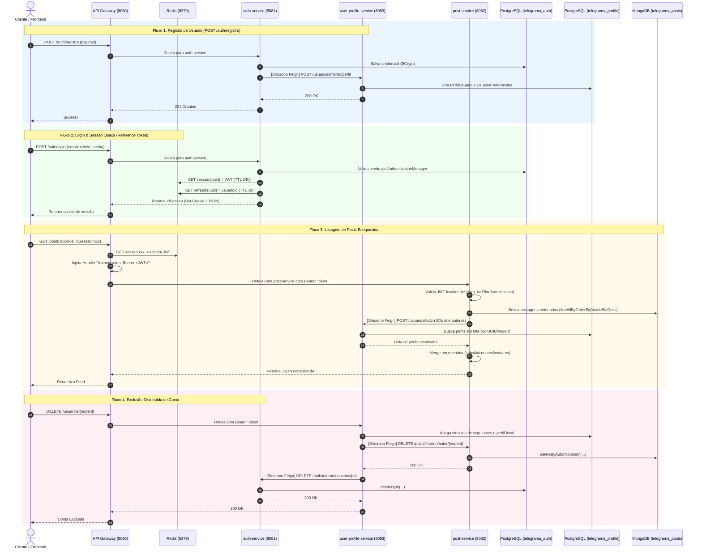
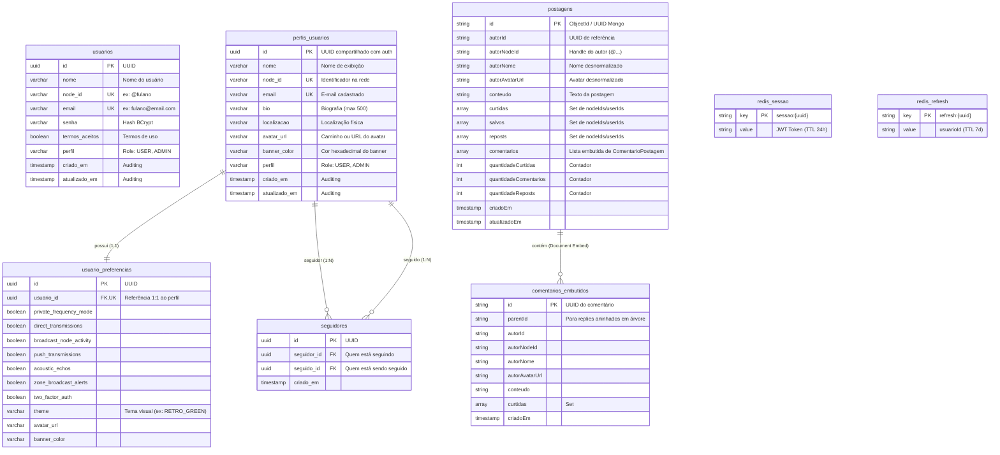

Ran list microservices directories
Ran check root files
Analyzed docker-compose.yml:L1-145
Ran locate pom.xml files
Ran map all source files
Ran inspect feed-service contents
Analyzed application.yaml:L1-3
Analyzed pom.xml:L1-61
Ran list api-gateway files
Analyzed application.yaml:L1-66
Analyzed FiltroAutenticacao.java:L1-75
Analyzed UtilidadesCriptografia.java:L1-33
Ran list auth-service files
Analyzed application.yaml:L1-36
Analyzed UserProfileClient.java:L1-13
Analyzed AuthService.java:L1-140
Analyzed UsuarioService.java:L1-112
Analyzed Usuario.java:L1-63
Ran list user-profile-service files
Analyzed AuthClient.java:L1-13
Analyzed PostClient.java:L1-13
Analyzed PerfilUsuarioService.java:L1-630
Ran list post-service files
Checked task List post-service files
Analyzed application.yaml:L1-20
Analyzed AuthClient.java:L1-16
Analyzed PostagemService.java:L1-652
Analyzed Postagem.java:L1-64
Analyzed ComentarioPostagem.java:L1-37
Analyzed PerfilUsuario.java:L1-85
Analyzed Seguidor.java:L1-47
Analyzed UsuarioPreferencias.java:L1-84

Esta é uma **vistoria técnica completa e aprofundada** da arquitetura de microsserviços do **Telegrama**, focada nas perguntas de backend e nas clássicas **"cascas de banana"** que professores de computação adoram fazer em bancas.

---

# 1. Visão Geral da Arquitetura & Topologia

O ecossistema é baseado em **Java 17, Spring Boot 3.3.1 e Spring Cloud 2023.0.2**, organizado em arquitetura poliglota de dados e orquestrado via Docker Compose:

```
[ Frontend / Cliente HTTP ]
           │
           ▼ (Porta 8080 - HTTP)
┌────────────────────────────────────────────────────────┐
│                      API GATEWAY                       │
│  - Spring Cloud Gateway (Reativo / WebFlux / Netty)    │
│  - GlobalFilter: FiltroAutenticacao (Order -1)         │
│  - Resolve X-Session-Id / Cookie no Redis -> Gera JWT  │
└───────┬──────────────┬──────────────┬──────────────────┘
        │              │              │
        ▼              ▼              ▼
┌──────────────┐┌──────────────┐┌──────────────┐
│ auth-service ││ user-profile ││ post-service │
│ (Porta 8081) ││ (Porta 8083) ││ (Porta 8082) │
│ [PostgreSQL] ││ [PostgreSQL] ││  [MongoDB]   │
└──────┬───────┘└──────┬───────┘└──────┬───────┘
       │               │               │
       └───────────────┴───────────────┘
                       ▲
                       │
       ┌───────────────────────────────┐
       │       service-discovery       │
       │    (Eureka Server - 8761)     │
       └───────────────────────────────┘
```

---

# 2. Como São Feitas as Chamadas: Síncronas vs. Assíncronas

###  Chamadas Síncronas (100% da malha atual)
* **Tecnologia:** **Spring Cloud OpenFeign** com resolução de instâncias via **Eureka Service Discovery** (`lb://nome-do-serviço`).
* **Protocolo:** HTTP/1.1 REST com payload JSON.
* **Pontos de comunicação síncrona entre microsserviços:**
  1. `auth-service` ➔ `user-profile-service`: Chamada síncrona no cadastro e no login (`POST /usuarios/interno/perfil`) para sincronizar ou criar o perfil do usuário.
  2. `user-profile-service` ➔ `post-service`: Chamada síncrona na exclusão de conta (`DELETE /posts/interno/autor/{nodeId}`) para deletar publicações em cascata.
  3. `user-profile-service` ➔ `auth-service`: Chamada síncrona na exclusão de conta (`DELETE /auth/interno/usuarios/{identificador}`) para apagar credenciais.
  4. `post-service` ➔ `user-profile-service`: Chamada síncrona via Feign (`POST /usuarios/batch`) durante a listagem de posts e comentários para enriquecer dados dos autores (nome e avatar atualizados).

###  Chamadas Assíncronas (Pegadinha!)
> **Atenção:** **Não há mensageria assíncrona orientada a eventos (Message Broker) implementada entre os microsserviços.** Não há Kafka, RabbitMQ, SQS nem Redis Pub/Sub ativos para eventos de domínio.
>
> A única coisa "assíncrona" do projeto é o **Spring Cloud Gateway**, que usa modelo **reativo não-bloqueante (Project Reactor / Netty / WebFlux)** com `Mono<Void>` e `ReactiveStringRedisTemplate` para lidar com requisições HTTP de entrada de forma não-bloqueante na I/O. **Mas a comunicação entre os microsserviços downstream é 100% síncrona request-response.**

---

# 3. Fluxograma Detalhado das Chamadas



---

# 4. Diagrama UML / ERD dos Bancos de Dados

O projeto adota **Database-per-Service** com persistência poliglota:



---

# 5. "Cascas de Banana" (Perguntas que o Professor de Backend vai Fazer)

Aqui estão as armadilhas exatas do seu código e como você deve responder para demonstrar domínio absoluto da arquitetura:

###  Casca 1: "Como vocês tratam transações distribuídas entre o Postgres do Auth e o Postgres do Profile no cadastro?"
* **A casca:** Em `UsuarioService.registrar`, o método tem `@Transactional` local no banco `telegrama_auth`. Logo após salvar o usuário, ele chama via Feign o `user-profile-service`. Se o `user-profile-service` der erro ou timeout, há um `try-catch` que engole a exceção e só faz `log.warn(...)`! O usuário é comitado no Auth, mas o perfil fica inexistente no Profile.
* **A pergunta do professor:** *"Se o user-profile-service estiver fora do ar no meio do cadastro, como fica a consistência dos dados? Vocês usam 2PC, Saga ou Outbox?"*
* **Como responder:**
  > *"Hoje temos uma consistência eventual oportunista com tolerância a falhas parciais. Se a chamada síncrona Feign falhar durante o cadastro, nós persistimos a credencial no Auth e registramos um aviso em log. Para mitigar o perfil órfão, implementamos um mecanismo de auto-cura (*self-healing*) no login (`AuthService.autenticar`), que verifica e sincroniza novamente o perfil se ele não existir. No entanto, reconhecemos que a abordagem ideal para produção é desacoplar esse fluxo com mensageria assíncrona (RabbitMQ/Kafka) usando o padrão **Transactional Outbox**, onde a criação do usuário emite um evento de domínio `UserRegisteredEvent` garantindo entrega garantida (*at-least-once*)."*

---

###  Casca 2: "E se a exclusão da conta falhar no meio do caminho?"
* **A casca:** Em `PerfilUsuarioService.excluirConta`, o serviço primeiro apaga o perfil local no Postgres, depois chama `postClient.excluirPostagensPorAutor` (Mongo) e depois chama `authClient.excluirCredencialInterna` (Postgres do Auth). Ambas as chamadas externas estão envolvidas em blocos `try-catch` separados que não dão rollback no banco local!
* **A pergunta do professor:** *"Se o auth-service cair na hora de excluir a conta, o usuário perde o perfil mas as credenciais e posts continuam no ar?"*
* **Como responder:**
  > *"Exato. Como temos bancos de dados independentes (Database-per-Service), uma transação ACID do Spring `@Transactional` não se estende aos outros microsserviços. No estágio atual, priorizamos a disponibilidade local e logamos falhas em cascata. Para um ambiente corporativo estrito, a solução recomendada é implementar o padrão **Saga Orquestrada** ou **Saga Coreografada**: um evento `UserDeletedEvent` seria emitido e cada microsserviço consumiria sua parte, com suporte a transações compensatórias em caso de falha irreversível."*

---

###  Casca 3: "O que faz o feed-service? Como o feed é gerado?"
* **A decisão arquitetural:** O microsserviço dedicado `feed-service` foi descontinuado e removido do projeto. A montagem do feed foi consolidada no `post-service`. A manutenção de um serviço independente apenas para o feed adicionava complexidade desnecessária e saltos de rede adicionais (REST hops) sem acrescentar lógica de domínio distinta.
* **A pergunta do professor:** *"Como o feed do usuário é montado? É Fan-out-on-Write (alimenta a timeline na publicação) ou Fan-out-on-Read (agrega em tempo real na leitura)?"*
* **Como responder:**
  > *"A montagem do feed é realizada por **Fan-out-on-Read** diretamente no `post-service`, que consulta o MongoDB com suporte a índices e ordenação por data de criação (`findAllByOrderByCriadoEmDesc`). Avaliamos a arquitetura e decidimos remover o `feed-service` intermediário para evitar latência desnecessária de rede (eliminação de saltos HTTP extras), centralizando a agregação e paginação de postagens diretamente no serviço de posts com suporte a enriquecimento em lote e cache Redis."*

---

###  Casca 4: "Vocês têm um problema de N+1 de rede / HTTP no feed?"
* **A casca:** Ao listar postagens no `post-service`, ele busca 10 ou 20 posts no MongoDB e depois precisa mostrar nome e avatar do autor.
* **A pergunta do professor:** *"Vocês fazem uma requisição HTTP para cada post para pegar a foto do autor?"*
* **Como responder:**
  > *"Não, nós evitamos o problema de N+1 HTTP implementando uma busca em lote (*Batch Enrichment*). O `post-service` extrai todos os identificadores únicos de autores da página retornada pelo Mongo e faz **uma única chamada síncrona** ao `user-profile-service` via endpoint `POST /usuarios/batch`. Além disso, se o serviço de perfil estiver temporariamente indisponível, nós usamos os dados desnormalizados do autor (`autorNome` e `autorAvatarUrl`) que já foram gravados no documento do MongoDB na criação do post, servindo como um fallback resiliente."*

---

###  Casca 5: "Concorrência em curtidas e comentários no MongoDB"
* **A casca:** Em `PostagemService.alternarCurtida`:
  ```java
  Postagem postagem = postagemRepository.findById(id).orElseThrow(...);
  postagem.getCurtidas().add(handleNodeId);
  postagemRepository.save(postagem);
  ```
* **A pergunta do professor:** *"Se 100 usuários curtirem a mesma publicação no mesmo milissegundo, o que acontece com a lista de curtidas?"*
* **Como responder:**
  > *"Esse é um ponto de contenção clássico: no modelo atual, estamos fazendo leitura-modificação-escrita em memória com `save()`. Em alta concorrência sem bloqueio otimista (`@Version`), podemos ter um problema de **Lost Update** (uma escrita sobrescrevendo a outra). A melhoria direta para este cenário é utilizar comandos atômicos do MongoDB através de `MongoTemplate`, aplicando `$addToSet` para curtir e `$pull` para descurtir com `$inc` no contador de curtidas, executando a mutação atomicamente a nível de documento no próprio banco de dados sem passar pelo estado em memória da JVM."*

---

###  Casca 6: "A autenticação é Stateless (JWT) ou Stateful (Sessão)? Por que os dois?"
* **A casca:** O projeto usa JWT, mas guarda o JWT no Redis e devolve um `idSessao` para o cliente.
* **A pergunta do professor:** *"Se vocês usam JWT, por que guardam sessão no Redis? Não perde a vantagem de ser stateless?"*
* **Como responder:**
  > *"Nós utilizamos o padrão de **Reference Token / Token Mediating** no API Gateway. Para o cliente externo (frontend/mobile), o sistema é stateful por motivos de segurança: ele trafega apenas um identificador opaco de sessão (`X-Session-Id` ou HttpOnly Cookie), impedindo que o JWT fique vulnerável a ataques XSS no navegador e permitindo **revogação imediata** (logout real ou invalidação de sessão no Redis). Porém, do Gateway para dentro da rede privada de microsserviços, o sistema opera de forma **stateless**: o Gateway busca o JWT no Redis e injeta no cabeçalho `Authorization: Bearer <token>`, permitindo que os microsserviços validem a assinatura criptográfica e os claims sem onerar o Redis com requisições repetidas."*

---

###  Casca 7: "E se a chave secreta de criptografia vazar?"
* **A casca:** No `api-gateway` e no `auth-service`, a classe `UtilidadesCriptografia` usa chave simétrica hardcoded `"TelegramaSecreta"` com `AES/ECB/PKCS5Padding`.
* **A pergunta do professor:** *"Vocês usam modo ECB em produção? Chaves no código?"*
* **Como responder:**
  > *"Em ambiente produtivo, hardcode de chaves e o modo AES-ECB não são recomendados porque o ECB não usa vetor de inicialização (IV), gerando cifras idênticas para blocos de dados idênticos. Para homologação e produção, o padrão arquitetural é externalizar essas credenciais via variáveis de ambiente injetadas por Secret Managers (Vault / AWS Secrets Manager) e migrar para **AES/GCM/NoPadding**, que fornece confidencialidade e autenticação de integridade (AEAD)."*

---

###  Casca 8: "Por que uma interface chamada AuthClient no post-service chama o user-profile-service?"
* **A casca:** Em `post-service/cliente/AuthClient.java`, a interface tem nome `AuthClient`, mas a anotação é `@FeignClient(name = "user-profile-service")` chamando `/usuarios/batch`.
* **A pergunta do professor:** *"O post-service depende do Auth ou do Profile?"*
* **Como responder:**
  > *"O `post-service` depende exclusivamente do `user-profile-service`. O nome da interface `AuthClient` é um débito técnico remanescente do início da modelagem, quando os serviços de autenticação e perfil ainda estavam unificados. Na refatoração para segregação de domínios, o endpoint `/usuarios/batch` migrou para o `user-profile-service`, mas a nomenclatura da classe cliente permaneceu; o correto semanticamente é renomeá-la para `UserProfileClient`."*

---

# 6. Resumo Rápido para a Apresentação

| Microsserviço | Porta | Banco / Armazenamento | Responsabilidade Principal | Comunicações que Realiza |
| :--- | :--- | :--- | :--- | :--- |
| **API Gateway** | 8080 | Redis (leitura) | Ponto único de entrada, CORS, tradução de Sessão Opaca para JWT Bearer | Roteamento para todos via Eureka |
| **Service Discovery** | 8761 | Em memória | Registro de serviços e heartbeat (Eureka) | Servidor passivo |
| **Auth Service** | 8081 | PostgreSQL (`telegrama_auth`) + Redis | Login, registro, refresh token, revogação de sessão | Feign ➔ `user-profile` (síncrono) |
| **User Profile Service** | 8083 | PostgreSQL (`telegrama_profile`) | Perfis, grafo de seguidores, preferências de usuário | Feign ➔ `auth`, Feign ➔ `post` (síncronos) |
| **Post Service** | 8082 | MongoDB (`telegrama_posts`) | Criação de posts, feed, likes, comentários em árvore | Feign ➔ `user-profile` (síncrono batch) |
| **Feed Service** | - | - | Provisionado/Stub (não implementado) | - |